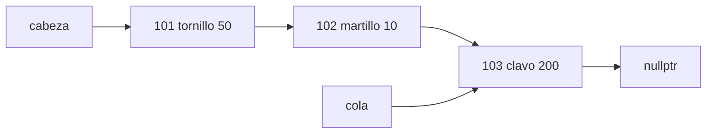

# Informe del avance

**Escenario A: inventario de una tienda**

**Estructura implementada desde cero:** lista enlazada simple.

## 1. El escenario

El programa permite llevar el inventario de una tienda. Cada artículo tiene un código entero positivo, un nombre de una sola palabra y una cantidad de unidades disponibles.
La persona encargada ingresa órdenes desde la entrada estándar, una por línea. Con ellas puede agregar artículos, consultar uno por su código, reponer unidades, eliminarlo o mostrar el inventario. Según la operación, el programa responde `ok`, `no existe` o muestra los datos del artículo.

## 2. Qué guarda la estructura y qué operaciones necesita

La información de cada artículo se guarda en un objeto de la clase `Articulo`, definido en `articulo.h`. La clase tiene tres atributos privados: `codigo`, `nombre` y `cantidad`. También cuenta con métodos para consultar esos datos, reponer unidades y mostrar el artículo.
La lista es genérica y está implementada en `listaEnlazadaSimple.h`. Cada nodo contiene un elemento y un puntero al siguiente nodo. La clase `Lista` mantiene un puntero a la cabeza, otro a la cola y un contador `n` con la cantidad de elementos. En el inventario se utiliza como `Lista<Articulo>`.
Las órdenes que maneja `main.cpp` son:

| Operación | Qué hace | Precondición |
|---|---|---|
| Agregar | Crea un artículo y lo agrega al final de la lista. Responde `ok`. | Código mayor que 0, nombre no vacío, cantidad mayor o igual que 0 y `n < 100`. El nombre debe caber en el arreglo de entrada de 30 caracteres. |
| Consultar | Busca el artículo y muestra `código nombre cantidad`. Si no lo encuentra, responde `no existe`. | Ninguna. |
| Reponer | Busca el artículo y suma las unidades indicadas. Responde `ok` o `no existe`. | Cantidad repuesta mayor que 0. |
| Eliminar | Busca el artículo y lo elimina de la lista. Responde `ok` o `no existe`. | Ninguna. |
| Listar | Recorre la lista y muestra los artículos en el orden en que se agregaron. | Ninguna; una lista vacía debe producir una salida vacía. |

Las condiciones de los artículos se comprueban mediante `assert` en el constructor de `Articulo` y en el método `reponer`. La capacidad se comprueba también mediante `assert` en `agregar()` e `insertar()`. Por eso, ingresar una orden `A` cuando ya hay 100 artículos no produce una respuesta como `no existe`: viola la precondición y provoca que el programa se detenga.

El código actual tampoco comprueba que los códigos sean únicos. Si se agrega más de un artículo con el mismo código, las búsquedas devuelven el primero que encuentren.

## 3. La estructura escogida y por qué

Escogimos una lista enlazada simple porque se ajusta a la forma en que se maneja el inventario. Los artículos nuevos se agregan al final y se conservan en el orden de llegada. Como la lista mantiene un puntero a la cola, la operación `agregar()` no necesita recorrer los nodos para encontrar dónde insertar el nuevo artículo.

También permite eliminar elementos de distintas posiciones sin desplazar los demás, como habría que hacer en un arreglo. Para eliminar un artículo, el programa primero lo busca por código y obtiene su posición. Después, la lista modifica los punteros necesarios y libera el nodo eliminado.

Los códigos no se mantienen ordenados, así que consultar o reponer un artículo requiere recorrer la lista hasta encontrarlo. En un arreglo sin ordenar también sería necesario buscar elemento por elemento. La lista, además, reserva memoria para cada nodo cuando se agrega un artículo y la libera cuando se elimina.

Como referencia para el análisis usamos *Introduction to Algorithms* (CLRS), 4.ª edición, capítulo 10: sección 10.2, sobre listas enlazadas, y sección 10.1, para la comparación con arreglos.

**Costos esperados**

Tomando `n` como la cantidad de artículos registrados, los costos de las operaciones del inventario son:

| Operación | Tiempo | Espacio | 
|---|---:|---:|
| Agregar | `O(1)` | `O(1)` | 
| Consultar | `O(n)` | `O(1)` | 
| Reponer | `O(n)` | `O(1)` | 
| Eliminar | `O(n)` | `O(1)` | 
| Listar | `O(n)` | `O(1)` | 

La operación `eliminar()` por posición puede ser constante cuando se elimina el primer nodo, pero en el caso general necesita llegar al nodo anterior. En el programa, además, antes de llamar a `eliminar()` se hace una búsqueda por código. Por eso, la operación completa `E` se considera `O(n)`.
La estructura utiliza `O(n)` de espacio total, porque reserva un nodo por artículo. El espacio auxiliar de las operaciones de la tabla es `O(1)`.

**Invariante de la estructura**

La lista debe conservar estas condiciones durante su funcionamiento:
```text
I1: 0 <= n <= 100
I2: si n == 0, entonces cabeza == nullptr y cola == nullptr
I3: si n > 0, entonces cola->siguiente == nullptr
```
La primera condición corresponde a la capacidad definida en el código. La segunda garantiza que, cuando no hay artículos, ninguno de los dos punteros señale a un nodo. La tercera indica que el último nodo no apunta a otro elemento.

**Ejemplo de la lista con tres artículos**



## 4. Qué pensamos medir

La capacidad de la lista es de 100 artículos, por lo que las mediciones deben mantenerse dentro de ese límite. Vamos a variar el número de elementos usando varios tamaños para probar que todo funcione correctamente en la lista. No tendría sentido probar tamaños de 1.000 o 100.000 con la implementación actual, porque la operación de agregar está limitada por `CAPACIDAD`.
Para cada tamaño vamos a medir las siguientes operaciones:

- **Llenar la lista:** agregar `n` artículos desde una lista vacía. Cada inserción cuesta `O(1)`, así que completar la lista debe crecer de forma lineal respecto a `n`.
- **Consultar:** buscar un artículo ubicado al principio, en la mitad y al final. También se buscará un código que no exista. Así se puede observar cuánto cambia el recorrido según la posición del artículo.
- **Reponer:** buscar artículos en esas mismas posiciones y sumarles unidades. El tiempo depende principalmente de la búsqueda, porque la suma se realiza en tiempo constante.
- **Eliminar:** eliminar artículos ubicados al principio, en la mitad y al final. En el programa, esta operación incluye la búsqueda por código y luego la eliminación por posición.
- **Listar:** recorrer y mostrar los `n` artículos. Esta prueba se realizará con listas no vacías; también se comprobará por separado que una lista vacía no provoque errores.

Las mismas pruebas se harán con `std::forward_list`, la estructura de la biblioteca escogida en el README. Para que la comparación sea justa, ambas implementaciones trabajarán con los mismos tamaños y respetarán el límite de 100 elementos. En la versión con `forward_list` se deberá llevar también un contador de elementos, porque esa estructura no ofrece el mismo manejo de `n` que nuestra clase.

Como los tamaños son pequeños, una sola ejecución puede ser demasiado rápida para medirla con precisión. Por eso, cada prueba se repetirá varias veces, se medirá el tiempo con un reloj de alta resolución y se registrará el promedio o la mediana. La creación de la lista se separará del tiempo de la operación que se esté evaluando. Para las pruebas de eliminación se reconstruirá la lista entre repeticiones, de modo que todas partan del mismo estado.

Los resultados se guardarán en archivos `.csv` dentro de `datos/`, con el tamaño de entrada, la operación, la estructura y el tiempo medido.

## 5. Casos de prueba

| *Caso* | *Entrada* | *Salida esperada* | *Salida obtenida* |
|---|---|---|---|
| funcional 1 | prueba-1.in | Confirmar que agregar, consultar, reponer y eliminar artículos funcionen correctamente. | ok |
| funcional 2 | pruebas-2.in | Verificar consultas inexistentes, códigos repetidos, cantidades en cero, valores extremos y operaciones sobre artículos existentes. | ok |
| funcional 3 | pruebas-3.in | Comprobar eliminaciones, reposiciones, reinserciones y consultas consecutivas, incluyendo el comportamiento de la lista vacía. | ok |
| límite | pruebas-4.in | Verificar que la lista admita 100 artículos y permita agregar uno nuevo después de eliminar un elemento. | ok |
