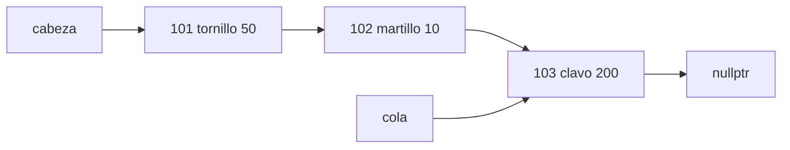

# Informe del avance

**Escenario A: inventario de una tienda**

**Estructura implementada desde cero:** lista enlazada simple.

## 1. El escenario

El programa administra el inventario de una tienda. Cada artículo tiene un código entero, un nombre de una sola palabra y una cantidad de unidades disponibles. La persona encargada ingresa primero el número de órdenes y luego las órdenes por la entrada estándar. Puede agregar artículos, consultar uno por su código, reponer unidades, eliminarlo o listar el inventario.

Al agregar un artículo con un código que no está registrado, el programa responde `ok`; si el código ya existe, responde `repetido`. Reponer o eliminar un artículo existente responde `ok`, y una búsqueda o eliminación de un código inexistente responde `no existe`. Consultar muestra `código nombre cantidad`; listar muestra los artículos en el orden en que fueron agregados. Listar un inventario vacío no imprime artículos.

## 2. Qué guarda la estructura y qué operaciones necesita

La clase `Articulo`, definida en `codigo/articulo.h`, guarda tres atributos privados: `codigo`, `nombre` y `cantidad`. Ofrece métodos para consultar esos valores, sumar una reposición a la cantidad y mostrar los datos del artículo.

La lista genérica `Lista`, definida en `codigo/listaEnlazadaSimple.h`, guarda elementos en nodos enlazados. Cada nodo contiene un elemento y un puntero al siguiente nodo. La lista mantiene un puntero al primer nodo (`cabeza`), un puntero al último (`cola`) y un contador (`n`). El inventario se declara como `Lista<Articulo>`. No hay una capacidad máxima fijada por la implementación; la lista agrega nodos dinámicamente mientras haya memoria disponible.

Las órdenes que maneja `codigo/main.cpp` son:

| Operación | Qué hace y qué responde | Condición considerada |
|---|---|---|
| Agregar | Agrega al final y responde `ok`, o responde `repetido` si ya existe el código. | El código debe ser único. El nombre se lee como una palabra de hasta 30 caracteres. No hay un tope de 100 artículos. |
| Consultar | Busca por código y muestra `código nombre cantidad`; si no existe, responde `no existe`. | El artículo debe existir para mostrar sus datos. |
| Reponer | Busca por código, suma la cantidad indicada y responde `ok`; si no existe, responde `no existe`. | El artículo debe existir. El código actual suma directamente el valor recibido. |
| Eliminar | Busca por código, elimina el artículo y responde `ok`; si no existe, responde `no existe`. | El artículo debe existir para eliminarlo. |
| Listar | Muestra todos los artículos en el orden de la lista. | Si la lista está vacía, no imprime artículos. |

La unicidad del código se comprueba en `main.cpp` antes de agregar. El constructor de `Articulo` y su método `reponer` no usan `assert` para validar los valores recibidos. La lista sí conserva aserciones en operaciones internas que requieren una posición válida, como insertar, asignar, eliminar o acceder a un nodo; estas condiciones corresponden a los índices usados por el programa.

## 3. La estructura escogida y por qué

Escogimos una lista enlazada simple porque permite agregar cada artículo al final en tiempo constante: la lista conserva un puntero a la cola y no necesita recorrer los nodos para encontrar el final. También permite eliminar un nodo sin desplazar los demás artículos, como ocurriría en un arreglo.

Las búsquedas se hacen por código y los artículos no están ordenados por ese campo. Por eso, consultar o reponer puede requerir recorrer todos los nodos. Para eliminar, el programa busca el código y obtiene la posición; luego la lista ajusta los enlaces y libera el nodo eliminado. La lista también libera todos sus nodos al destruirse.

La lista enlazada simple se presenta en *Introduction to Algorithms* (CLRS), capítulo 10, sección 10.2 [1]. Tomamos esa sección como referencia para describir los nodos, sus enlaces y las operaciones de recorrido e inserción. La sección 10.1 presenta arreglos y sus operaciones [1]; en un arreglo, eliminar un elemento intermedio requiere desplazar los elementos siguientes. Para este inventario se escogió la lista por la inserción al final y la eliminación sin desplazamientos, aceptando que la búsqueda por código es lineal.

**Costos esperados**

Tomando `n` como la cantidad de artículos registrados:

| Operación del inventario | Tiempo | Espacio auxiliar | Razón |
|---|---:|---:|---|
| Agregar | `O(1)` | `O(1)` | Se enlaza un nodo nuevo usando `cola`. |
| Consultar | `O(n)` | `O(1)` | En el peor caso se revisan todos los nodos. |
| Reponer | `O(n)` | `O(1)` | La búsqueda puede recorrer toda la lista; la suma es constante. |
| Eliminar | `O(n)` | `O(1)` | La búsqueda por código y la localización del nodo anterior son lineales en conjunto. |
| Listar | `O(n)` | `O(1)` | Se visita cada nodo una vez. |

El espacio total de la lista es `O(n)`, porque hay un nodo por artículo. Insertar, eliminar o acceder por posición puede requerir recorrer hasta `n` nodos; el costo constante de `agregar` se debe específicamente a que la lista mantiene `cola`. Estos costos se derivan de recorrer los enlaces hasta encontrar la posición o el artículo, y del acceso directo a `cola` para agregar al final [1, sección 10.2].

**Invariante de la estructura**

Durante las operaciones, la lista mantiene estas condiciones:

1. `n` es el número de nodos enlazados desde `cabeza`.
2. Si `n == 0`, `cabeza` y `cola` son nulos.
3. Si `n > 0`, `cabeza` y `cola` señalan nodos de la lista, `cola` es el último nodo y `cola->siguiente` es nulo.

Estas condiciones describen la estructura sin imponer un límite máximo de elementos.

**Ejemplo de la lista con tres artículos**

## 4. Qué pensamos medir

Se medirán varios tamaños de inventario, sin imponer un límite artificial de 100 elementos. Para cada tamaño se observarán estas operaciones:

- **Llenar la lista:** agregar `n` artículos desde una lista vacía. Cada inserción al final cuesta `O(1)`, así que llenar la lista debe crecer linealmente con `n`.
- **Consultar:** buscar artículos al principio, en la mitad y al final, además de buscar un código inexistente, para observar cómo cambia el recorrido.
- **Reponer:** buscar artículos en esas posiciones y sumar unidades. El costo depende principalmente de la búsqueda.
- **Eliminar:** eliminar artículos al principio, en la mitad y al final. La medición incluye la búsqueda por código y la eliminación del nodo.
- **Listar:** recorrer y mostrar los `n` artículos; también se comprobará el caso de una lista vacía.

La comparación prevista es con `std::forward_list`, la estructura de biblioteca indicada en el `README.md`. Ambas implementaciones deben recibir las mismas secuencias y tamaños. Para que la comparación sea equivalente, se medirá la misma operación con los mismos datos y se llevará un contador de elementos para la versión de biblioteca, que no ofrece el mismo contador mantenido por `Lista`.

Cada medición se repetirá varias veces para reducir el efecto de variaciones de una ejecución. Se registrará el tiempo y se resumirán las repeticiones con una medida como el promedio o la mediana. La preparación de los datos se separará de la operación medida; para eliminar, se reconstruirá la estructura entre repeticiones para partir del mismo estado. Los resultados se guardarán en archivos `.csv` dentro de `datos/`, con el tamaño, la operación, la estructura y el tiempo medido.

## 5. Casos de prueba

Cada entrada de `datos/` tiene una salida esperada con el mismo nombre base. La entrada y la salida permiten comparar la respuesta del programa con la esperada.

| Caso | Entrada y cobertura | Salida esperada |
|---|---|---|
| Funcional 1 | `prueba-1.in`: agregar, consultar, reponer y eliminar artículos, incluida una consulta posterior a eliminar. | `prueba-1.out` |
| Funcional 2 | `pruebas-2.in`: inventario vacío, artículos existentes e inexistentes, código repetido, reposiciones, eliminaciones y listado. | `pruebas-2.out` |
| Funcional 3 | `pruebas-3.in`: código entero grande, cantidad inicial cero, reposiciones, duplicados, eliminación, reinserción y consultas. | `pruebas-3.out` |
| Límite de crecimiento | `pruebas-4.in`: agrega 100 artículos, consulta y elimina el último y agrega el artículo 101. Comprueba que la lista no tiene un tope fijo de 100. | `pruebas-4.out` |

Desde `codigo/`, el objetivo `make pruebas` corre las entradas que tengan un `.out` correspondiente en `datos/` y compara las salidas.

## Referencias

[1] T. H. Cormen, C. E. Leiserson, R. L. Rivest y C. Stein, *Introduction to Algorithms*, 4.ª ed., MIT Press, 2022, cap. 10, secciones 10.1 y 10.2. ISBN 978-0-262-04630-5. [Ficha editorial de MIT Press](https://mitpress.mit.edu/9780262046305/introduction-to-algorithms/).
