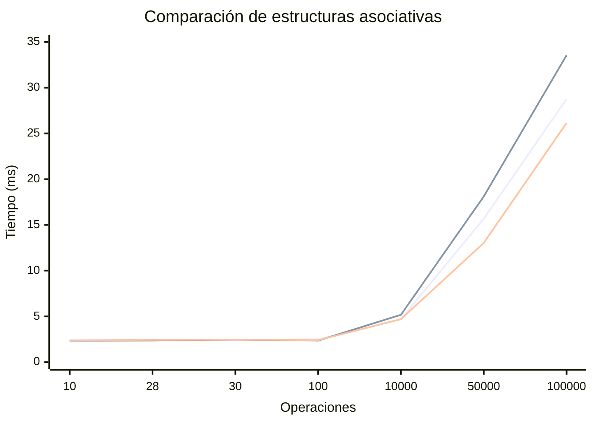
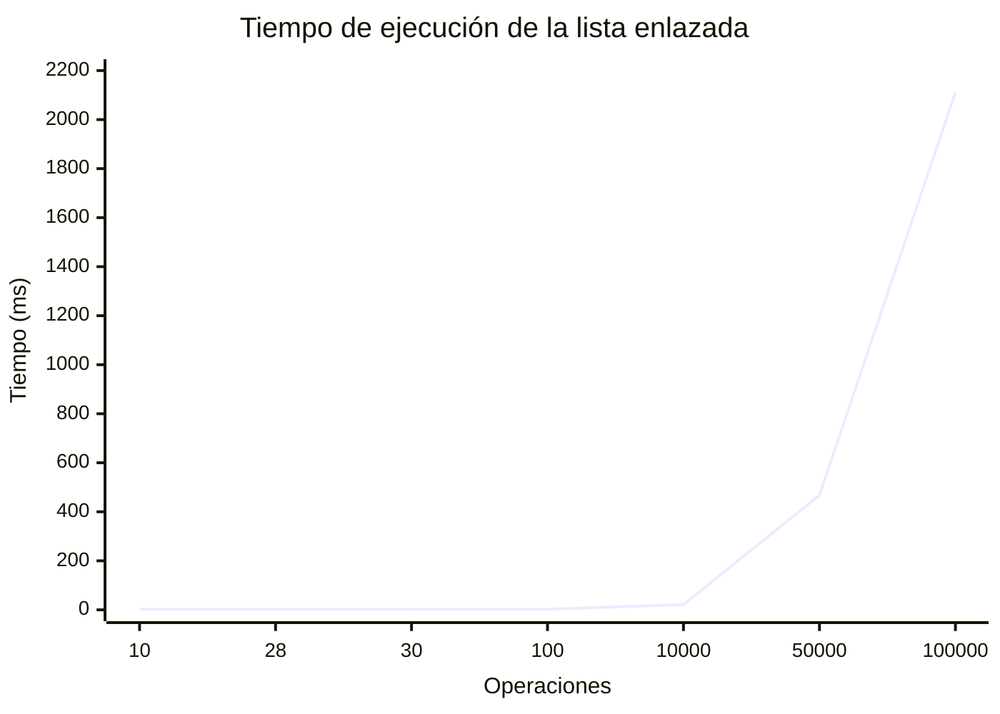

# Informe final

## 1. El escenario y el modelado

El programa administra el inventario de una tienda. Cada artículo tiene un código entero, un nombre de una sola palabra y una cantidad de unidades disponibles. La persona encargada ingresa primero el número de órdenes y luego las órdenes por la entrada estándar. Puede agregar artículos, consultar uno por su código, reponer unidades, eliminarlo o listar el inventario.
Al agregar un artículo con un código que no está registrado, el programa responde ok; si el código ya existe, responde repetido. Reponer o eliminar un artículo existente responde ok, y una búsqueda o eliminación de un código inexistente responde no existe. Consultar muestra código, nombre y cantidad; listar muestra los artículos almacenados. El orden de presentación depende de la estructura utilizada: una lista enlazada puede conservar el orden de inserción, std::map ordena por clave y las tablas hash no garantizan un orden específico. Listar un inventario vacío no imprime artículos.

## 2. Las cuatro estructuras

| Operación | Lista enlazada | Tabla Hash propia | std::map | std::unordered_map |
|---|---|---|---|---|
| Agregar | Inserción en la lista | agregar(llave, valor) | insert() | insert() |
| Consultar | Recorrido de la lista | consultar(llave) | find(llave) | find(llave) |
| Eliminar | Búsqueda y eliminación del nodo | eliminar(llave) | erase(llave) | erase(llave) |
| Verificar existencia | Recorrido de la lista | consultar(llave) | count(llave) | count(llave) |
| Verificar si está vacía | vacia() | vacia() | empty() | empty() |
| Redimensionar | No aplica | rehash(tam) | No aplica | rehash() |
| Cantidad de elementos | tamano() | tamano() | size() | size() |

Las cuatro estructuras permiten administrar artículos mediante un código que funciona como identificador. Sin embargo, utilizan mecanismos diferentes para almacenar y localizar los elementos. La lista enlazada organiza los artículos mediante nodos conectados entre sí. Para encontrar un elemento es necesario recorrer la lista hasta localizar su código.
La tabla hash propia utiliza una función hash para determinar la posición donde se almacena cada elemento. Las colisiones se resuelven mediante encadenamiento con listas enlazadas. Esto permite acceder directamente a una posición de la tabla y recorrer únicamente los elementos que comparten esa posición.
std::map utiliza una estructura de árbol balanceado que mantiene las claves ordenadas. Esto permite realizar búsquedas, inserciones y eliminaciones sin recorrer todos los elementos.
Por último, std::unordered_map es una implementación de tabla hash proporcionada por la biblioteca estándar de C++. Administra internamente las colisiones y el redimensionamiento. La principal diferencia es que la tabla hash propia permite controlar directamente su implementación, mientras que std::map y std::unordered_map ofrecen estructuras optimizadas y administradas por la biblioteca estándar.

## 3. Análisis formal de complejidad

La tabla hash propia utiliza encadenamiento mediante listas enlazadas para resolver las colisiones. Cada posición de la tabla contiene una lista de registros que comparten el mismo resultado de la función hash.

La función hash utilizada es:

$$
h(k)=k \bmod m
$$

Donde k representa la llave y m el tamaño de la tabla.

El factor de carga se mantiene como máximo en 1. Cuando una inserción provoca que se supere este valor, se ejecuta un proceso de redimensionamiento que redistribuye los elementos (rehash).

### Complejidad de las operaciones

| Operación | Lista enlazada | Tabla Hash propia | std::map | std::unordered_map |
|---|---|---|---|---|
| Agregar | O(n) | O(1) promedio, O(n) peor caso | O(log n) | O(1) promedio, O(n) peor caso |
| Consultar | O(n) | O(1) promedio, O(n) peor caso | O(log n) | O(1) promedio, O(n) peor caso |
| Eliminar | O(n) | O(1) promedio, O(n) peor caso | O(log n) | O(1) promedio, O(n) peor caso |
| Verificar existencia | O(n) | O(1) promedio, O(n) peor caso | O(log n) | O(1) promedio, O(n) peor caso |
| Verificar si está vacía | O(1) | O(1) | O(1) | O(1) |
| Redimensionar | No aplica | O(n) | No aplica | O(n) |

* Se considera que la implementación mantiene un contador de elementos o una referencia que permite conocer si la estructura está vacía en tiempo constante.

En la lista enlazada, agregar un elemento requiere comprobar primero que su código no esté repetido. Por eso, aunque insertar un nodo al inicio puede tomar O(1), la operación completa tiene un costo de O(n) cuando se verifica la existencia de la clave.

En la tabla hash propia y en std::unordered_map, las operaciones principales presentan un costo promedio constante bajo condiciones adecuadas de distribución de claves y control del factor de carga.

En std::map, las operaciones principales tienen un costo logarítmico debido a que el árbol balanceado mantiene una altura proporcional a log n.

Aquí, n representa la cantidad de elementos almacenados.

### Demostración de complejidad de las operaciones

#### 1. Búsqueda en tabla hash

**Teorema.** La operación de búsqueda en una tabla hash con encadenamiento presenta una complejidad temporal esperada de O(1), siempre que se mantenga un factor de carga acotado por una constante.

**Demostración.** Se procede a determinar la cantidad esperada de elementos que deben recorrerse en la lista asociada a una posición de la tabla hash.

*Desarrollo.*

Sea n la cantidad de elementos almacenados y m la cantidad de posiciones disponibles en la tabla. El factor de carga se define como:

$$
\alpha = \frac{n}{m}
$$

Bajo el supuesto de hashing uniforme, la cantidad esperada de elementos en una lista es proporcional al factor de carga. Por tanto:

$$
E[T(n)] \leq 1 + \alpha
$$

Si el factor de carga se encuentra limitado por una constante A, entonces:

$$
\alpha \leq A
$$

Sustituyendo:

$$
E[T(n)] \leq 1 + A
$$

Definiendo c = 1 + A, se obtiene:

$$
E[T(n)] \leq c \cdot 1
$$

para todo n ≥ 1.

*Conclusión.*

Por lo tanto, la operación de búsqueda presenta una complejidad temporal esperada de O(1), con testigos c = 1 + A y k = 1.

#### 2. Inserción en tabla hash

**Teorema.** La operación de inserción en una tabla hash con encadenamiento presenta una complejidad temporal esperada de O(1), siempre que el factor de carga se encuentre acotado y no sea necesario realizar un redimensionamiento.

**Demostración.** Se analiza el cálculo de la posición correspondiente mediante la función hash y la inserción del nuevo elemento en la lista asociada.

*Desarrollo.*

El cálculo de la posición mediante la función hash requiere tiempo constante:

$$
T_{\text{hash}}(n) = a
$$

donde a es una constante.

Si la inserción requiere comprobar previamente si la clave ya existe, se debe recorrer la lista correspondiente. Bajo hashing uniforme, el costo esperado de este recorrido está acotado por:

$$
E[T_{\text{recorrido}}(n)] \leq b(1+\alpha)
$$

Como el factor de carga está limitado por una constante A:

$$
E[T_{\text{recorrido}}(n)] \leq b(1+A)
$$

Sumando el cálculo del hash y la inserción:

$$
E[T(n)] \leq a+b(1+A)+d
$$

donde d representa el costo constante de insertar el elemento.

Definiendo:

$$
c = a+b(1+A)+d
$$

Se obtiene:

$$
E[T(n)] \leq c \cdot 1
$$

para todo n ≥ 1, siempre que no ocurra un redimensionamiento.

*Conclusión.*

Por lo tanto, la inserción presenta una complejidad temporal esperada de O(1), sin considerar el costo de un eventual redimensionamiento, con testigos c = a+b(1+A)+d y k = 1.

#### 3. Eliminación en tabla hash

**Teorema.** La operación de eliminación en una tabla hash con encadenamiento presenta una complejidad temporal esperada de O(1), siempre que el factor de carga esté acotado por una constante.

**Demostración.** Se procede a localizar el elemento mediante su clave y posteriormente eliminarlo de la lista correspondiente.

*Desarrollo.*

Primero, se calcula la posición del elemento mediante la función hash, cuyo costo es constante:

$$
T_{\text{hash}}(n) = a
$$

Después, se recorre la lista asociada hasta encontrar la clave que se desea eliminar. Bajo el supuesto de hashing uniforme:

$$
E[T_{\text{búsqueda}}(n)] \leq b(1+\alpha)
$$

Como el factor de carga está limitado por una constante A:

$$
E[T_{\text{búsqueda}}(n)] \leq b(1+A)
$$

Una vez localizado el elemento, su eliminación mediante encadenamiento requiere un número constante de operaciones:

$$
T_{\text{eliminación}}(n) = d
$$

Por lo tanto, el tiempo total esperado está limitado por:

$$
E[T(n)] \leq a+b(1+A)+d
$$

Definiendo:

$$
c = a+b(1+A)+d
$$

Se obtiene:

$$
E[T(n)] \leq c \cdot 1
$$

*Conclusión.*

Por lo tanto, la eliminación presenta una complejidad temporal esperada de O(1), con testigos c = a+b(1+A)+d y k = 1.

#### 4. Operaciones principales en std::map

**Teorema.** Las operaciones de búsqueda, inserción y eliminación en std::map presentan una complejidad temporal de O(log n), debido a que esta estructura utiliza un árbol balanceado.

**Demostración.** Se analiza la cantidad de niveles que deben recorrerse para localizar una clave dentro del árbol.

*Desarrollo.*

Un árbol balanceado mantiene su altura proporcional al logaritmo de la cantidad de elementos. Por tanto, existen constantes a y b tales que:

$$
h(n) \leq a\log_2(n)+b
$$

En una búsqueda, cada comparación permite continuar por una de las ramas del árbol. Por esta razón, la cantidad de operaciones está limitada por su altura:

$$
T(n) \leq c_1\log_2(n)+c_2
$$

La inserción y la eliminación también requieren localizar la posición correspondiente y realizar ajustes para conservar el balance del árbol. Estos procesos mantienen un costo proporcional a su altura:

$$
T(n) \leq c_3\log_2(n)+c_4
$$

Por lo tanto, para constantes apropiadas C y un valor inicial k, se obtiene:

$$
T(n) \leq C\log_2(n)
$$

para n ≥ k, ajustando la constante para absorber los costos adicionales.

*Conclusión.*

Las operaciones principales de std::map presentan una complejidad temporal de O(log n), tanto en el caso promedio como en el peor caso, debido al mantenimiento del balance del árbol.

### Consideraciones

Las demostraciones anteriores corresponden al comportamiento esperado de una tabla hash bajo el supuesto de hashing uniforme y un factor de carga acotado.
El redimensionamiento de la tabla hash propia puede requerir recorrer los elementos almacenados y volver a calcular sus posiciones. Por esta razón, su costo individual puede ser O(n).
Asimismo, las cotas presentadas no representan una garantía para cualquier distribución de claves. En el peor caso, si todos los elementos terminan en una misma posición, las operaciones de búsqueda, inserción y eliminación pueden alcanzar una complejidad de O(n).
En std::map, el costo logarítmico se mantiene gracias al balance del árbol. En cambio, std::unordered_map depende de la distribución de las claves y del manejo interno de las colisiones.

### Resumen de costos

| Estructura | Búsqueda | Inserción | Eliminación | Característica principal |
|---|---|---|---|---|
| Lista enlazada | O(n) | O(n) | O(n) | Requiere recorrer los nodos |
| Tabla Hash propia | O(1) promedio | O(1) promedio | O(1) promedio | Permite controlar el manejo de colisiones |
| std::map | O(log n) | O(log n) | O(log n) | Mantiene las claves ordenadas |
| std::unordered_map | O(1) promedio | O(1) promedio | O(1) promedio | Tabla hash administrada por la biblioteca estándar |

* Considerando que la inserción verifica previamente que no exista una clave repetida.

## 4. Experimentos

Los experimentos se realizaron en un equipo HP Victus 15, con procesador AMD Ryzen 7 7445HS y 16 GB de memoria RAM.

Se utilizó g++, con las banderas -O2 -std=c++17, habilitando optimizaciones y utilizando el estándar C++17.

Se ejecutaron siete casos de prueba utilizando los mismos archivos de entrada para las cuatro estructuras. Cada caso se ejecutó varias veces (aprox 100) y se calculó el promedio de los tiempos obtenidos. Los tiempos se registraron en milisegundos.

### Resultados promedio del benchmark

| Caso de prueba | Lista (ms) | Tabla Hash (ms) | Map (ms) | Unordered (ms) |
|:---|---:|---:|---:|---:|
| prueba-1.in | 2.350 | 2.430 | 2.340 | 2.370 |
| prueba-2.in | 2.400 | 2.400 | 2.360 | 2.440 |
| prueba-3.in | 2.410 | 2.440 | 2.450 | 2.460 |
| prueba-4.in | 2.370 | 2.500 | 2.350 | 2.400 |
| prueba-5.in | 21.480 | 4.700 | 5.180 | 4.700 |
| prueba-6.in | 467.490 | 15.670 | 18.110 | 13.030 |
| prueba-7.in | 2111.000 | 28.760 | 33.540 | 26.150 |

### Gráfica comparativa de las estructuras asociativas

La siguiente gráfica compara la tabla hash propia, std::map y std::unordered_map. Se excluye la lista enlazada para permitir observar las diferencias entre las tres estructuras sin que sus tiempos de ejecución más elevados alteren la escala.

**Convenciones:**
🟦 Tabla hash propia
🟪 std::map
🟧 std::unordered_map

### Gráfica de la lista enlazada

Debido a que los tiempos de la lista enlazada son considerablemente mayores en los casos de mayor tamaño, se presenta su comportamiento por separado.

## 5. Lo medido contra lo predicho

Según el análisis teórico, las cuatro estructuras presentan comportamientos diferentes a medida que aumenta la cantidad de elementos procesados.

La lista enlazada presenta una complejidad O(n) para buscar un artículo, ya que debe recorrer sus nodos hasta encontrar el código correspondiente. Esto se refleja especialmente en las pruebas de mayor tamaño, donde sus tiempos aumentan considerablemente.

La tabla hash propia y std::unordered_map presentan una complejidad promedio de O(1) para sus operaciones principales, bajo condiciones adecuadas de distribución de claves y control del factor de carga. En los resultados experimentales ambas estructuras muestran tiempos inferiores a los de la lista enlazada en los casos de mayor tamaño.

Por otro lado, std::map presenta una complejidad O(log n) debido a su implementación mediante un árbol balanceado. Aunque su complejidad teórica es superior a la esperada de una tabla hash, sus tiempos experimentales son cercanos a los de las otras dos estructuras asociativas.

Al observar las pruebas de mayor tamaño se obtienen los siguientes resultados:

- **10.000 operaciones:** la tabla hash propia tardó 4.700 ms, std::map tardó 5.180 ms y std::unordered_map tardó 4.700 ms. La lista enlazada tardó 21.480 ms.
- **50.000 operaciones:** la tabla hash propia tardó 15.670 ms, std::map tardó 18.110 ms y std::unordered_map tardó 13.030 ms. La lista enlazada tardó 467.490 ms.
- **100.000 operaciones:** la tabla hash propia tardó 28.760 ms, std::map tardó 33.540 ms y std::unordered_map tardó 26.150 ms. La lista enlazada tardó 2111.000 ms.

En los casos de 10.000, 50.000 y 100.000 operaciones, std::unordered_map presenta los mejores tiempos o comparte el menor resultado con la tabla hash propia. std::map obtiene tiempos ligeramente superiores, mientras que la lista enlazada presenta un crecimiento mucho más pronunciado.
Estos resultados son coherentes con las complejidades teóricas: las estructuras asociativas permiten localizar elementos sin recorrer todo el inventario, mientras que la lista enlazada debe realizar búsquedas secuenciales.
También es importante considerar que la complejidad asintótica no determina por sí sola el tiempo real de ejecución. Factores como la administración de memoria, las comparaciones, el manejo de colisiones, el balance del árbol y las operaciones internas de cada estructura influyen en los resultados.
Los tiempos de las pruebas pequeñas son bastante cercanos entre sí. Esto puede deberse a que, cuando se procesan pocos elementos, el costo fijo de iniciar el programa y otros procesos del sistema representa una parte importante del tiempo total medido.

## 6. Conclusiones

La comparación permitió observar las diferencias entre una lista enlazada, una tabla hash implementada desde cero y dos estructuras proporcionadas por la biblioteca estándar de C++.
La lista enlazada es la alternativa más sencilla de implementar, pero presenta limitaciones cuando aumenta la cantidad de elementos, debido a que sus búsquedas requieren recorrer los nodos. Esto se evidencia especialmente en las pruebas de 50.000 y 100.000 operaciones.
La tabla hash propia demuestra que es posible construir una estructura eficiente utilizando encadenamiento y redimensionamiento. Además, permite comprender y controlar directamente los procesos de almacenamiento, búsqueda y eliminación.
std::map ofrece una alternativa basada en árboles. Aunque sus operaciones principales tienen complejidad O(log n), mantiene un rendimiento competitivo en las pruebas y proporciona la ventaja de almacenar los elementos ordenados por clave.
Por su parte, std::unordered_map presenta los mejores resultados en las pruebas de mayor tamaño. Su comportamiento experimental es consistente con su complejidad promedio O(1), y permite aprovechar una implementación administrada por la biblioteca estándar.
Para este proyecto, las cuatro estructuras son funcionales, pero responden a necesidades diferentes. La lista enlazada permite estudiar el funcionamiento de las estructuras lineales; la tabla hash propia permite comprender la implementación de una tabla hash; std::map resulta conveniente cuando se necesita mantener los elementos ordenados; y std::unordered_map es una alternativa adecuada cuando se prioriza el acceso promedio rápido mediante claves.
En términos de rendimiento para los casos evaluados, std::unordered_map resulta la alternativa más favorable entre las cuatro estructuras, especialmente cuando aumenta la cantidad de operaciones.
